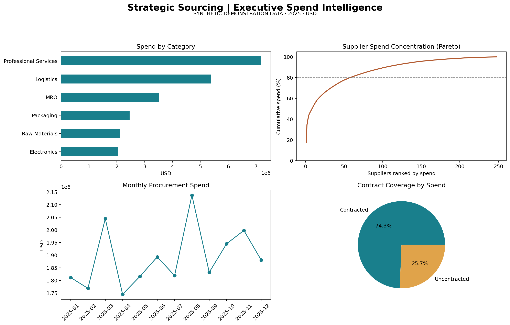

# Strategic Sourcing Intelligence
### Executive Procurement Analytics | Cost Optimization | Python Automation

**Transforming procurement transaction data into actionable sourcing strategies and quantified cost-saving opportunities.**

This project demonstrates an automated procurement intelligence workflow designed to help sourcing leaders identify purchasing inefficiencies, evaluate contract coverage, prioritize sourcing opportunities, and support data-driven financial decisions.

The analysis uses **synthetic 2025 procurement data** and Python-based automation to simulate an executive-level cost optimization initiative.

---

## Executive Dashboard



## 1. Business Challenge

Procurement organizations often manage substantial purchasing volumes across numerous suppliers and categories. Without centralized spend visibility, organizations may struggle to identify:

- Off-contract purchasing and missed negotiation opportunities
- Fragmented spend across suppliers and categories
- Opportunities to improve contract utilization
- High-impact categories for strategic sourcing initiatives
- Potential cost savings that justify leadership investment

**Executive question:** How can procurement leadership use transaction-level data to identify, quantify, and prioritize cost optimization opportunities?

## 2. Executive Findings

| Key Performance Indicator | Result |
|---|---:|
| Annual Procurement Spend | $22.69M |
| Active Suppliers | 248 |
| Off-Contract Spend | $5.82M |
| Off-Contract Spend Share | 25.7% |
| Moderate Savings Opportunity | $145.5K |
| Top 10 Supplier Spend Share | 52.21% |

**Key insight:** Approximately one-quarter of purchasing spend falls outside contracted agreements, presenting an opportunity to evaluate contract coverage, purchasing compliance, and negotiated pricing.

These findings are derived from synthetic demonstration data.

## 3. Financial Opportunity: Savings Scenarios

A scenario-based savings model evaluates potential financial benefits by applying different assumptions for addressable off-contract spend and achievable savings rates.

| Scenario | Addressable Spend | Assumed Savings Rate | Estimated Annual Savings |
|---|---:|---:|---:|
| Conservative | 25% | 2% | $29.1K |
| Moderate | 50% | 5% | $145.5K |
| Ambitious | 75% | 8% | $349.3K |

**Moderate scenario:** Addressing 50% of the $5.82M in off-contract spend at an assumed 5% savings rate produces an estimated $145.5K annual savings opportunity.

These are illustrative financial scenarios, not realized savings, validated supplier quotations, or guaranteed outcomes.

## 4. Prioritized Sourcing Opportunities

The Python analysis ranks purchasing categories by estimated savings opportunity under the moderate scenario.

| Priority | Category | Estimated Savings |
|---|---|---:|
| 1 | Professional Services | $43.9K |
| 2 | MRO | $28.7K |
| 3 | Packaging | $27.7K |
| 4 | Raw Materials | $21.2K |
| 5 | Electronics | $15.9K |

The ranking is based on off-contract spend exposure and uniform scenario assumptions. It serves as a preliminary prioritization tool, not a validated assessment of supplier negotiability or implementation feasibility.

## 5. Executive Recommendations

**Priority 1: Improve contract coverage**

Review high-value off-contract purchases, beginning with Professional Services. Evaluate opportunities to establish negotiated agreements, strengthen contract adoption, and reduce unmanaged spend.

**Priority 2: Target high-impact purchasing categories**

Assess MRO and Packaging for purchasing consolidation, supplier negotiations, and standardized buying practices.

**Priority 3: Establish procurement performance monitoring**

Introduce recurring reporting for contract coverage, off-contract spend, category-level savings opportunities, and validated realized savings.

## 6. Illustrative 90-Day Action Plan

| Timeline | Recommended Initiative | Expected Deliverable |
|---|---|---|
| Days 1–30 | Validate spend classifications and identify off-contract purchasing drivers | Contract leakage assessment |
| Days 31–60 | Prioritize sourcing categories and evaluate negotiation opportunities | Category sourcing action plans |
| Days 61–90 | Launch selected initiatives and establish KPI tracking | Procurement performance scorecard |

This roadmap is a proposed management approach, not an implementation completed by the project.

## 7. Technical Implementation

**Technology:** Python, pandas, matplotlib, CSV data processing

The automated analysis:

1. Validates transaction records and supplier references.
2. Calculates supplier and category spending.
3. Measures contract coverage and off-contract exposure.
4. Flags potentially duplicate invoice records for review.
5. Calculates conservative, moderate, and ambitious savings scenarios.
6. Ranks categories by modeled sourcing opportunity.
7. Generates CSV reports and an executive dashboard.

### Run the Project

```bash
python3 -m pip install -r requirements.txt
python3 analyze.py
```

Generated reports are saved in the `outputs/` directory.

### Key Outputs

- `executive_summary.csv`
- `savings_scenarios.csv`
- `sourcing_opportunities.csv`
- `supplier_spend.csv`
- `category_spend.csv`
- `duplicate_invoice_flags.csv`
- `concentration_flags.csv`
- `sourcing_dashboard.png`

## 8. Business and Technical Skills Demonstrated

**Strategic sourcing:** Spend analysis, contract optimization, category prioritization, and procurement efficiency.

**Financial analytics:** Scenario modeling, estimated savings quantification, and executive KPI development.

**Technical execution:** Python automation, data validation, pandas transformations, reporting, and matplotlib visualization.

**Executive communication:** Translating analytical results into financial insights, prioritized recommendations, and an actionable implementation roadmap.

---

**Data disclaimer:** This project uses entirely synthetic procurement and supplier data. All financial opportunities are illustrative estimates based on stated assumptions. No proprietary company data, actual negotiated savings, or verified business outcomes are represented.
